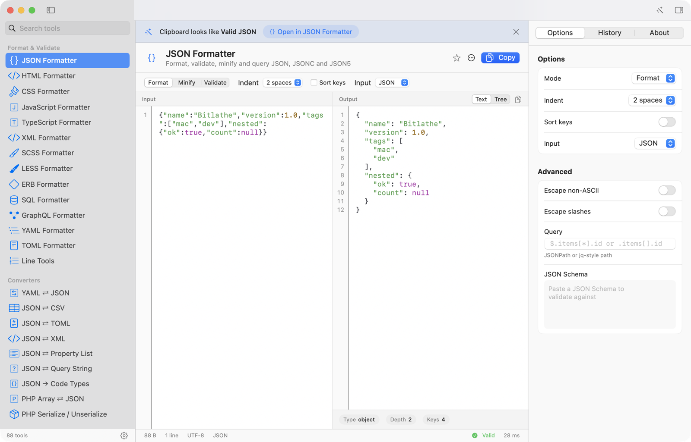
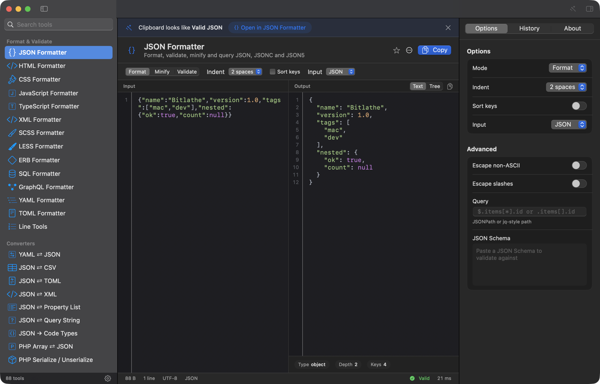
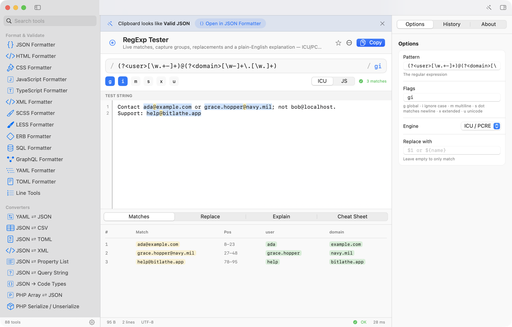
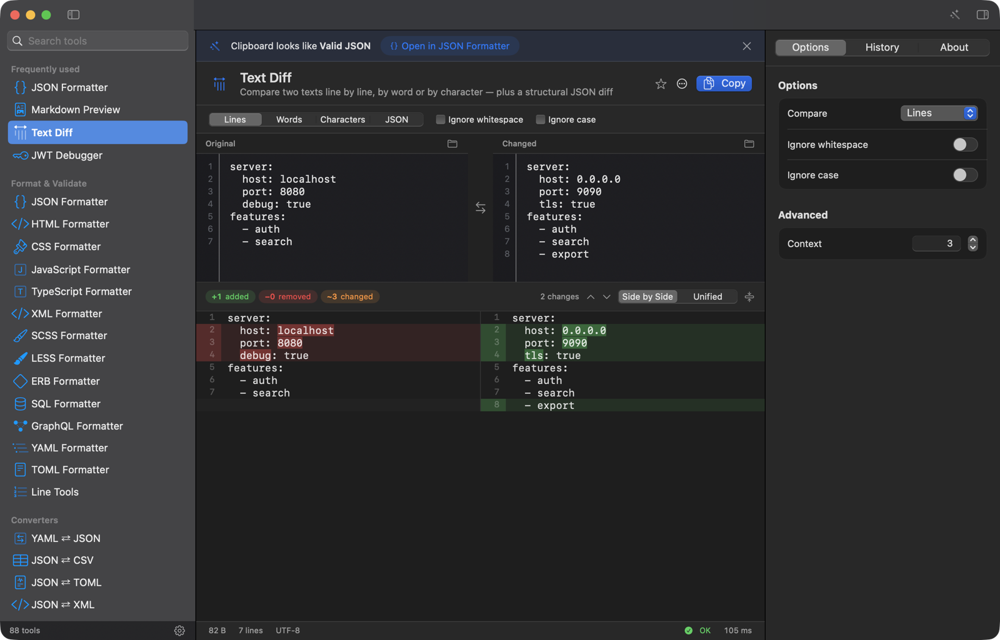
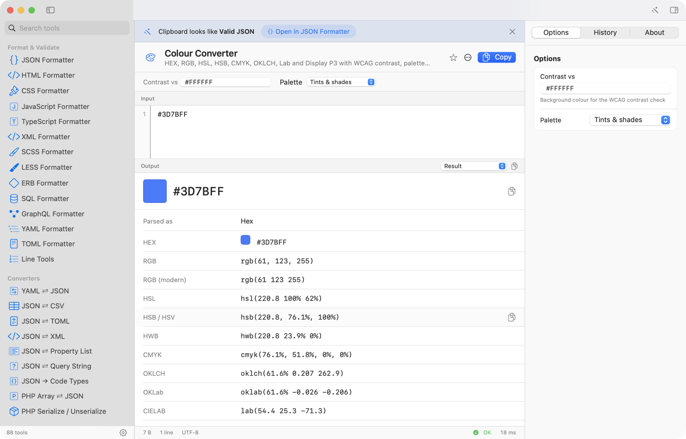
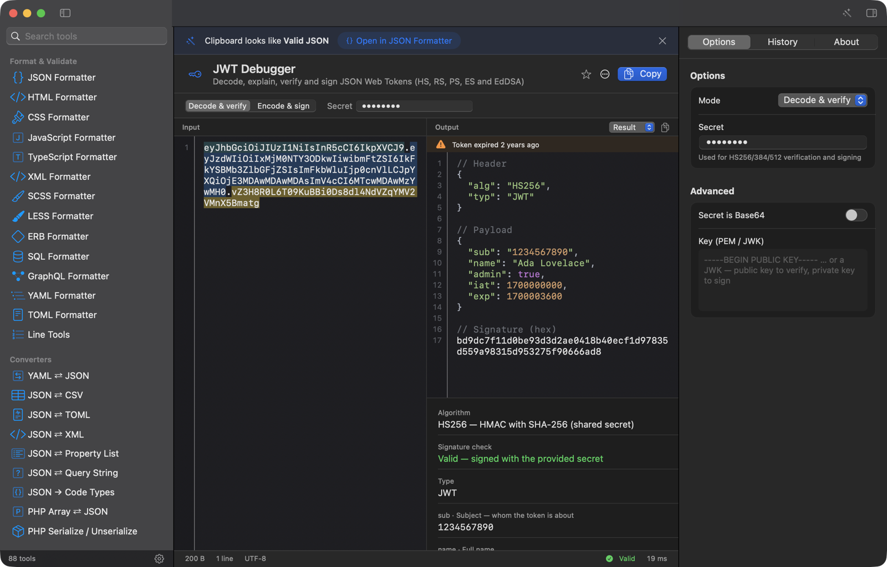
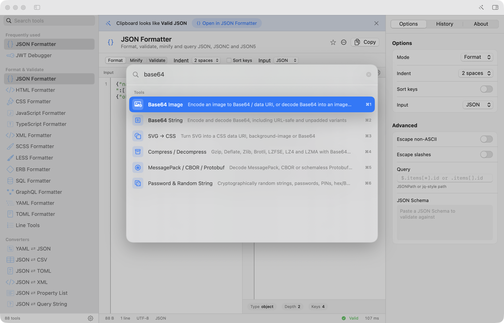
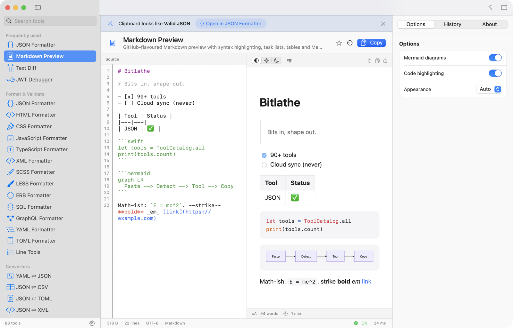
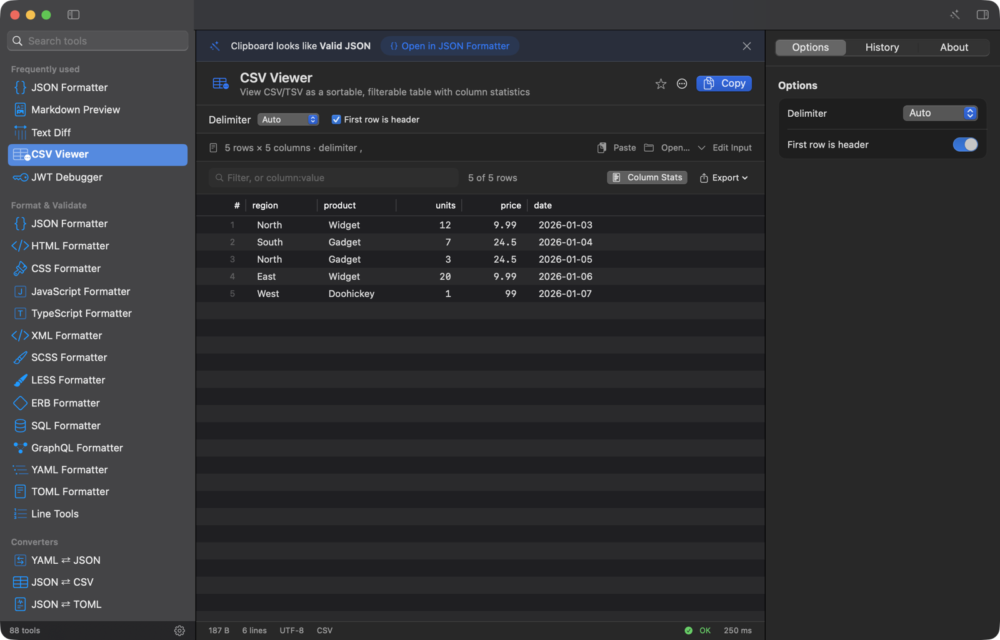

# Bitlathe

**A native macOS developer toolbox. 88 offline utilities, one fast window, one command line.**

Paste something, and Bitlathe works out what it is: JSON, a JWT, a Unix timestamp, a colour, a cron expression. It opens the right tool with your input already in place. Everything runs on your Mac, and nothing you paste is uploaded anywhere.



Bitlathe is written in Swift 6 and SwiftUI for macOS 14 and later. It is not an Electron or web wrapper. Formatters such as Prettier and sql-formatter run inside the system `JavaScriptCore` engine, so there is no Node and no network.

> Status: pre-release (version 0.1.0). Some app-level features are still in progress. See [TOOLS.md](TOOLS.md) for the live checklist.

## A quick tour

### Format, validate and explore JSON

Format, minify and validate JSON (also JSON5 and JSONC input), switch to a collapsible tree with search and copy-path, run JSONPath or jq-style queries, and validate against a JSON Schema.

| Light | Dark |
|---|---|
|  |  |

### Test regular expressions live

Live match highlighting, capture-group table, replacement preview, a plain-English explanation and a cheat sheet. Switch between ICU/PCRE and JavaScript engines.



### Compare text and JSON

Side-by-side or unified diff, with line, word and character granularity, plus a structural JSON diff.



### Convert colours

HEX, RGB, HSL, HSB, HWB, CMYK, OKLCH, OKLab, Lab and Display P3, with WCAG contrast checking and generated palettes.



### Debug JWTs

Decode header and payload, verify HS/RS/ES/EdDSA signatures, or encode and sign a new token.



### Jump anywhere with the command palette

Press <kbd>⌘K</kbd> to fuzzy-search every tool and action, and recent inputs.



### Preview Markdown, with Mermaid

GitHub-flavoured Markdown with syntax-highlighted code blocks and Mermaid diagrams, rendered offline. The HTML preview is sandboxed with JavaScript off.



### Explore CSV

A sortable, filterable table with per-column statistics and CSV or JSON export.



## Also in the app

- **Smart detection.** Bitlathe can check the clipboard when the window comes forward and offers to open the matching tool (a banner, with "Also try" alternatives). Smart Paste is <kbd>⌘⌥V</kbd>. Detection can be switched off, and individual tools can be excluded, in Settings.
- **History, favourites and pinned inputs** per tool, stored locally. An opt-in developer clipboard history is off by default.
- **Inspector** with options, history and tool details.
- **Appearance.** Light, dark or automatic, six editor themes, configurable font and zoom.
- **Menu bar Quick Panel.** Press <kbd>⌃⌥Space</kbd> anywhere to see the clipboard already transformed, then press Return to copy. Option-click the menu bar icon to copy straight away.
- **Pipelines.** Chain tools visually, with each step's output shown live. Pipelines can be saved, exported and run from the CLI.
- **Scratchpad.** <kbd>⌥⌘P</kbd> opens a plain editor where any text tool applies in place, to each selection.
- **User scripts.** Drop a JavaScript file in the scripts folder and it becomes a tool; ten examples ship with the app. See [Docs/Scripting.md](Docs/Scripting.md).
- **Everywhere else on the Mac.** Services menu items, `bitlathe://` links ([Docs/URLScheme.md](Docs/URLScheme.md)), Shortcuts actions ([Docs/Shortcuts.md](Docs/Shortcuts.md)), Quick Look previews for JWT, CSR, JSON and YAML files, and Raycast and Alfred integrations in `Integrations/`.

The full status of each feature, including what is still in progress, is in [TOOLS.md](TOOLS.md).

## Tools

88 tools in six categories. This list is generated from `bl list --json`; regenerate it with `.build/release/bl list --json | scripts/gen-tool-table.py`.

<details>
<summary><b>Format & validate</b> (14)</summary>

| `bl` id | Tool | What it does |
|---|---|---|
| `css.format` | CSS Formatter | Beautify or minify CSS |
| `erb.format` | ERB Formatter | Beautify HTML templates with embedded Ruby |
| `graphql.format` | GraphQL Formatter | Beautify GraphQL queries and schemas |
| `html.format` | HTML Formatter | Beautify or minify HTML |
| `js.format` | JavaScript Formatter | Beautify or minify JavaScript |
| `json.format` | JSON Formatter | Format, validate, minify and query JSON, JSONC and JSON5 |
| `less.format` | LESS Formatter | Beautify LESS |
| `scss.format` | SCSS Formatter | Beautify SCSS |
| `sql.format` | SQL Formatter | Format SQL for PostgreSQL, MySQL, BigQuery, Snowflake, SQLite and more |
| `text.lines` | Line Tools | Sort, dedupe, reverse, shuffle, trim, number, prefix and join lines |
| `toml.format` | TOML Formatter | Format and validate TOML |
| `ts.format` | TypeScript Formatter | Beautify TypeScript and TSX |
| `xml.format` | XML Formatter | Beautify, minify and validate XML |
| `yaml.format` | YAML Formatter | Format and validate YAML with precise error locations |

</details>

<details>
<summary><b>Converters</b> (21)</summary>

| `bl` id | Tool | What it does |
|---|---|---|
| `code.to-curl` | Code / HTTP → cURL | Build a curl command from a raw HTTP request, fetch() call, axios or Python requests snippet |
| `convert.bytesize` | Byte Size Converter | Bytes, KB/KiB, MB/MiB, GB/GiB, TB/TiB and bits — decimal and binary at once |
| `convert.json-csv` | JSON ⇄ CSV | Convert arrays of objects to CSV/TSV and back |
| `convert.json-plist` | JSON ⇄ Property List | Convert between JSON and XML or binary property lists |
| `convert.json-query` | JSON ⇄ Query String | Convert URL query strings to JSON and back (supports a[b]=1 and a[]=1) |
| `convert.json-toml` | JSON ⇄ TOML | Convert between JSON and TOML |
| `convert.json-xml` | JSON ⇄ XML | Convert between JSON and XML (attributes as @keys, text as #text) |
| `convert.markdown-html` | Markdown ⇄ HTML | Render GitHub-flavoured Markdown to HTML, or turn HTML back into Markdown |
| `convert.units` | Developer Units | Time durations, data rates and CSS px/pt/rem/em |
| `convert.yaml-json` | YAML ⇄ JSON | Convert between YAML and JSON in either direction |
| `csv.viewer` | CSV Viewer | View CSV/TSV as a sortable, filterable table with column statistics |
| `curl.to-code` | cURL → Code | Turn a curl command into Swift, Python, JavaScript, Node, Go, Rust, PHP or Ruby |
| `hex.text` | Hex ⇄ Text | Convert text to hex, UTF-8 bytes, binary, decimal bytes and back |
| `html.to-jsx` | HTML → JSX | Convert HTML to React JSX (className, htmlFor, style objects, self-closing tags) |
| `json.to-code` | JSON → Code Types | Generate TypeScript, Swift, Go, Kotlin, Rust, Python, C#, Java or JSON Schema from JSON |
| `number.base` | Number Base Converter | Binary, octal, decimal, hex, base 32/36 and custom bases, signed and unsigned |
| `php.array-json` | PHP Array ⇄ JSON | Convert PHP array literals to JSON and back |
| `php.serialize` | PHP Serialize / Unserialize | Convert between PHP serialize() format and JSON |
| `svg.to-code` | SVG → SwiftUI / React | Convert SVG paths to a SwiftUI Shape or a React component |
| `svg.to-css` | SVG → CSS | Turn SVG into a CSS data URI, background-image or Base64 |
| `text.case` | Case Converter | camelCase, PascalCase, snake_case, kebab-case, CONSTANT_CASE, Title, Sentence, dot.case and path/case at once |

</details>

<details>
<summary><b>Encoders & decoders</b> (14)</summary>

| `bl` id | Tool | What it does |
|---|---|---|
| `base32.text` | Base32 | Base32 (RFC 4648), base32hex and Crockford encode / decode |
| `base58.text` | Base58 | Base58 (Bitcoin alphabet) encode / decode, with optional Base58Check |
| `base64.image` | Base64 Image | Encode an image to Base64 / data URI, or decode Base64 into an image preview |
| `base64.text` | Base64 String | Encode and decode Base64, including URL-safe and unpadded variants |
| `base85.text` | Base85 / Ascii85 | Ascii85 (Adobe), Z85 and RFC 1924 Base85 encode / decode |
| `binary.decode` | MessagePack / CBOR / Protobuf | Decode MessagePack, CBOR or schemaless Protobuf (hex, Base64 or raw bytes) to JSON — and encode JSON back |
| `compress.text` | Compress / Decompress | Gzip, Deflate, Zlib, Brotli, LZFSE, LZ4 and LZMA with Base64 or hex wrapping |
| `html.entities` | HTML Entities | Encode text as HTML entities (named, decimal or hex) and decode entities back |
| `punycode.idn` | Punycode / IDN | Convert internationalised domain names to xn-- Punycode and back |
| `quoted.printable` | Quoted-Printable | Encode and decode MIME quoted-printable text (and =?UTF-8?Q?…?= headers) |
| `string.escape` | String Escaper | Escape text as a literal for JSON, Swift, JavaScript, Python, Go, SQL, shell, regex, CSV, C, Java or HTML attributes |
| `text.backslash` | Backslash Escape | Escape or unescape backslash sequences (\n, \t, \", \\, \uXXXX) |
| `unicode.escape` | Unicode Escape | Convert between é, \u00e9, \u{e9}, &#233;, &#xE9;, %C3%A9, U+00E9 and \xC3\xA9 |
| `url.encode` | URL Encode / Decode | Percent-encode a component or a full URL, and decode back |

</details>

<details>
<summary><b>Inspect, preview & debug</b> (22)</summary>

| `bl` id | Tool | What it does |
|---|---|---|
| `cert.x509` | Certificate Decoder | Decode X.509 certificates, chains, CSRs and keys (PEM or DER): subject, SANs, validity, fingerprints |
| `chmod.calc` | chmod Calculator | Convert between octal (755), symbolic (rwxr-xr-x) and chmod flags, with setuid/setgid/sticky |
| `cidr.calc` | CIDR / Subnet Calculator | Network, broadcast, host range, mask and address class for IPv4 and IPv6 blocks |
| `color.convert` | Colour Converter | HEX, RGB, HSL, HSB, CMYK, OKLCH, Lab and Display P3 with WCAG contrast, palettes and code output |
| `cron.parse` | Cron Parser | Explain cron expressions in plain English and list the next run times (standard, Quartz and AWS EventBridge) |
| `env.inspect` | .env Inspector | Parse and validate .env files, flag duplicates, mask secrets, and convert to JSON, Docker, shell or Kubernetes |
| `file.checksum` | File Checksum | Drop a file to get MD5, SHA-1, SHA-256, SHA-512, CRC32 and compare against an expected hash |
| `hex.viewer` | Hex Viewer | Inspect any file or text as a hex dump with offsets, ASCII column and file-type detection |
| `html.preview` | HTML Preview | Render HTML in a sandboxed, offline web view (JavaScript off by default) |
| `http.reference` | HTTP Reference | Look up HTTP status codes, headers and methods |
| `image.exif` | Image Metadata | EXIF, GPS, TIFF, IPTC and colour profile data from any image — and a stripped copy |
| `jwt.debug` | JWT Debugger | Decode, explain, verify and sign JSON Web Tokens (HS, RS, PS, ES and EdDSA) |
| `markdown.preview` | Markdown Preview | GitHub-flavoured Markdown preview with syntax highlighting, task lists, tables and Mermaid diagrams |
| `mime.lookup` | MIME Type Lookup | Find the MIME type for a file extension, the extensions for a MIME type, and the UTI |
| `regex.test` | RegExp Tester | Live matches, capture groups, replacements and a plain-English explanation — ICU/PCRE-style or JavaScript semantics |
| `semver.compare` | Semver Comparator | Parse, compare and sort semantic versions, and test them against npm/Cargo-style ranges |
| `ssh.fingerprint` | SSH Key Fingerprint | MD5 and SHA-256 fingerprints, key type, bits and randomart for OpenSSH public keys |
| `string.inspect` | String Inspector | Length, bytes, words, lines and per-character code points — flags invisible characters, homoglyphs and mixed line endings |
| `text.diff` | Text Diff | Compare two texts line by line, by word or by character — plus a structural JSON diff |
| `time.unix` | Unix Time Converter | Seconds, milliseconds, microseconds and nanoseconds ⇄ dates in any time zone, with relative time |
| `url.parse` | URL Parser | Break a URL into scheme, host, port, path, query parameters and fragment — and rebuild it live |
| `useragent.parse` | User-Agent Parser | Identify browser, engine, OS, device and bots from a User-Agent string |

</details>

<details>
<summary><b>Generators</b> (14)</summary>

| `bl` id | Tool | What it does |
|---|---|---|
| `aes.gcm` | AES-GCM Encrypt / Decrypt | Authenticated encryption of text with a passphrase (PBKDF2-SHA256) or a raw key, plus ChaCha20-Poly1305 |
| `barcode` | Barcode | Generate Code 128, Code 39, EAN-13, EAN-8, UPC-A, PDF417 and Aztec barcodes, or read any barcode from an image |
| `fake.data` | Fake Data Generator | Realistic test records — names, emails, addresses, IBANs, cards, IPs, dates — as JSON, CSV or SQL, reproducible with a seed |
| `gitignore.build` | .gitignore Builder | Compose a .gitignore from built-in templates for languages, frameworks, editors and operating systems |
| `hash.generate` | Hash Generator | MD5, SHA-1, SHA-2, SHA-3, Keccak, BLAKE2, BLAKE3, CRC32 and HMAC for text or files |
| `icon.set` | App Icon & Favicon Set | Turn one square image into .icns, .ico, favicons, or an iOS/macOS asset catalogue |
| `id.generate` | UUID / ULID / ID Generator | Generate and decode UUID v1/v3/v4/v5/v7, ULID, Nano ID and MongoDB ObjectId |
| `image.placeholder` | Placeholder Image | Generate placeholder images of any size with colours and a label — PNG, JPEG or SVG |
| `key.generate` | Key Generator | Generate RSA, EC (P-256/384/521), Ed25519 and symmetric keys as PEM, JWK, OpenSSH or raw bytes |
| `lorem.ipsum` | Lorem Ipsum | Placeholder text: classic Latin, hipster, tech jargon or corporate, as words, sentences or paragraphs |
| `oauth.pkce` | OAuth PKCE | Generate a PKCE code verifier and S256 challenge, plus state and nonce values — or verify a pair |
| `password.hash` | Password Hashing | Hash and verify passwords with bcrypt, scrypt and Argon2id |
| `qr.code` | QR Code | Generate QR codes with colours, a centre logo and error correction — PNG or SVG — and read QR codes from images |
| `random.string` | Password & Random String | Cryptographically random strings, passwords, PINs, hex/Base64 tokens and diceware passphrases with a strength meter |

</details>

<details>
<summary><b>Images & media</b> (3)</summary>

| `bl` id | Tool | What it does |
|---|---|---|
| `image.convert` | Image Convert & Resize | Convert between PNG, JPEG, HEIC, WebP, TIFF, GIF and BMP, resize, compress and strip metadata |
| `ocr.text` | OCR — Text from Image | Extract text from screenshots and photos on-device with Vision, with per-line confidence |
| `svg.optimize` | SVG Optimiser | Shrink SVGs: strip editor metadata, comments and defaults, round numbers and collapse whitespace |

</details>

## Install and build from source

There are no prebuilt releases yet. To build you need macOS 14 or later, Xcode 16.4 or later, and [XcodeGen](https://github.com/yonaskolb/XcodeGen).

```sh
brew install xcodegen
git clone https://github.com/Rxmeez/bitlathe.git
cd bitlathe

scripts/run.sh                 # generate the Xcode project, build the app (Debug) and launch it
scripts/run.sh release         # same, Release configuration
BUILD_ONLY=1 scripts/run.sh    # build without launching

make test                      # swift test: engine unit tests
make cli                       # build the `bl` command-line tool
```

`make cli` builds `.build/release/bl`. Copy it onto your `PATH` if you want it everywhere, for example `cp .build/release/bl /usr/local/bin/`.

## Command line

The `bl` tool runs the same engines as the app. It reads standard input (or a file argument) and writes to standard output.

```sh
bl <tool.id> [--option value]… [file]
bl list [--json] [--category <name>]
bl detect [text]
bl <tool.id> --help
```

Real examples:

```console
$ echo '{"b":2,"a":[1,2,{"z":null}]}' | bl json.format --sortKeys true --indent 2
{
  "a": [
    1,
    2,
    {
      "z": null
    }
  ],
  "b": 2
}

$ bl base64.text --mode decode <<< "SGVsbG8="
Hello

$ echo 1700000000 | bl time.unix
Interpreted as: Unix seconds
Local (Europe/London): Tuesday, 14 November 2023 at 22:13:20 GMT
Relative: 2 years ago
ISO 8601 (UTC): 2023-11-14T22:13:20.000Z
…

$ bl id.generate --kind uuid7 --count 2
01a1d385-5e92-7032-b263-b424a09910d7
01a1d385-5e92-795d-9f14-e5e6be6ff8a1

$ echo 'eyJhbGciOiJIUzI1NiJ9.eyJzdWIiOiIxMjMifQ.x' | bl detect
 98%  jwt.debug               JSON Web Token
```

Exit codes: 0 success, 1 tool error, 2 usage error. Options for each tool are listed by `bl <tool.id> --help`.

## Privacy

- **Everything runs on-device.** There is no account, no analytics, no telemetry and no cloud sync. Bitlathe does not send what you paste anywhere.
- **Sandboxed.** The app runs in the macOS App Sandbox with user-selected file access only.
- **One network-related entitlement, and why.** Inside the App Sandbox, WebKit's renderer stays blank unless the app holds `com.apple.security.network.client`, even for local HTML. The HTML and Markdown previews therefore carry that entitlement, and then block every request: a content rule list denies all URLs except `about:`, `data:` and `blob:`, all navigation is cancelled apart from in-page anchors, and the web view uses a non-persistent data store. Links open in your default browser only when you click them. The rest of the app makes no network requests. The decision is recorded in [Docs/Decisions.md](Docs/Decisions.md).
- **Local data.** History, favourites and usage counts live in a single SQLite file in the app's Application Support folder (inside its sandbox container). The `bl` tool shares the same file. You can disable history globally or per tool, set a retention period, and clear it, in Settings. Clipboard history is opt-in.

## Documentation

See [Docs/README.md](Docs/README.md) for an index. [ARCHITECTURE.md](ARCHITECTURE.md) describes how the code is organised.

## Licence

Copyright (c) Bitlathe authors. All rights reserved. No open-source licence has been granted for the Bitlathe source code; this section will be updated if one is added.

Third-party components keep their own licences. See [THIRD_PARTY_NOTICES.md](THIRD_PARTY_NOTICES.md).

## Acknowledgements

Bitlathe stands on excellent open-source work:

- [Yams](https://github.com/jpsim/Yams) (with LibYAML) and [TOMLKit](https://github.com/LebJe/TOMLKit) (with toml++) for YAML and TOML.
- [Prettier](https://prettier.io), [sql-formatter](https://github.com/sql-formatter-org/sql-formatter), [Terser](https://terser.org), [marked](https://marked.js.org), [Mermaid](https://mermaid.js.org) and [highlight.js](https://highlightjs.org), run inside JavaScriptCore.
- The [EFF short word list](https://www.eff.org/deeplinks/2016/07/new-wordlists-random-passphrases) for passphrase generation (CC BY 3.0).
- The idea of a tidy developer toolbox owes much to [DevUtils](https://devutils.com).
